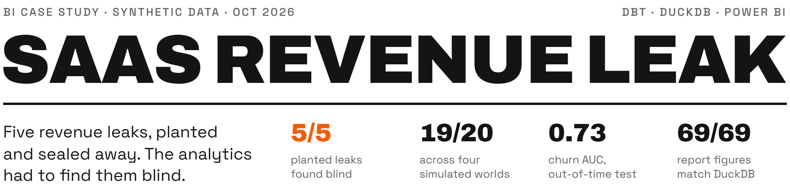
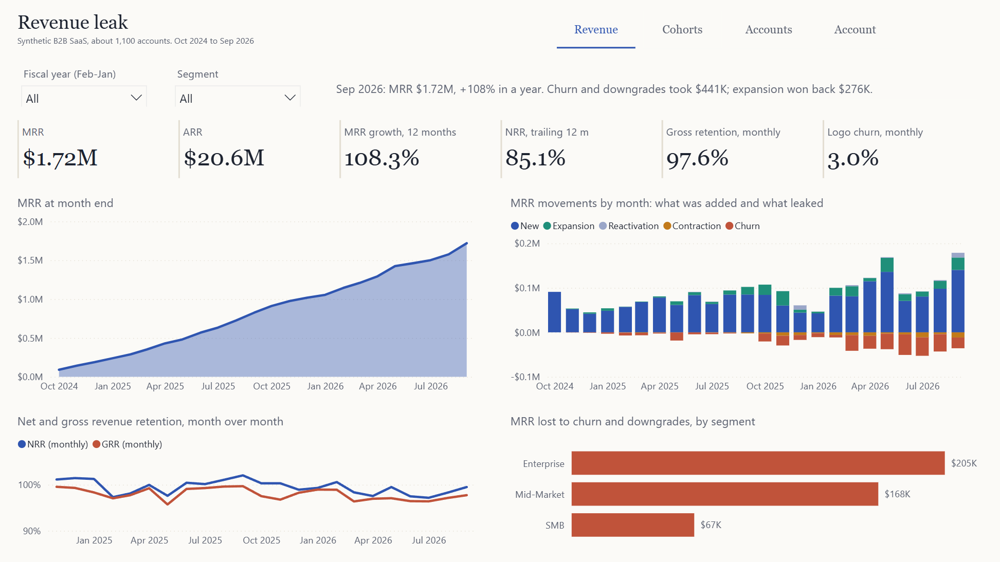

<picture>
  <source media="(max-width: 600px) and (prefers-color-scheme: dark)" srcset=".github/assets/header-phone-dark.png">
  <source media="(max-width: 600px) and (prefers-color-scheme: light)" srcset=".github/assets/header-phone-light.png">
  <source media="(prefers-color-scheme: dark)" srcset=".github/assets/header-dark.png">
  <source media="(prefers-color-scheme: light)" srcset=".github/assets/header-light.png">
  
</picture>

A B2B SaaS revenue analytics engine built so it can be graded: a Python simulation of a subscription business, dbt on DuckDB with a Kimball star schema, an anomaly monitor, a churn model and a Power BI report generated entirely from code. The incidents and their true causes sit in a sealed answer key that only the scorecard reads, so the results measure what the analytics found, not what they were told.

[Case study (PDF)](docs/case-study.pdf) · [Portfolio page](https://damanjz.github.io/portfolio/projects/saas-revenue-leak/) · [](https://github.com/damanjz/saas-revenue-leak-bi/actions/workflows/ci.yml)

## Results

| Figure | Result | How it is produced |
|---|---|---|
| Planted leaks found by the monitor | 5 of 5 on the main run | `scorecard/score.py`, seed 42, full scale; [docs/scorecard.md](docs/scorecard.md) |
| Across four simulated worlds | 19 of 20 (the neglected account-manager book was missed on seed 7) | `scorecard/multi_seed.py`, seeds 42, 7, 2024 and 31337; [docs/multi_seed_v2.md](docs/multi_seed_v2.md) |
| Churn model, out of time | ROC AUC 0.73; the riskiest 10% churn at 2.9x the base rate | `ml/churn_model.py`, trained to December 2025, tested March to August 2026; [docs/scorecard.md](docs/scorecard.md) |
| Report figures vs DuckDB | 69 of 69 match; 66 of 66 measures evaluate | `powerbi/check_report.py` |
| False alarms | 3 on the main run (10 before the detectors were rebuilt as statistical tests) | [docs/scorecard.md](docs/scorecard.md), [docs/detector_revisions.md](docs/detector_revisions.md) |
| Churn early warning | 44% of churns flagged in the 60 days before, median 41 days ahead | [docs/scorecard.md](docs/scorecard.md) |
| Injected data problems | 13 of 13 types caught by tests (39,161 dirty rows); 12 fully, and 18,774 of 18,806 sessions missing an end where injections overlap | [docs/scorecard.md](docs/scorecard.md), section 2 |
| dbt build: tests and enforced contracts | 105 nodes, 0 errors; 8 warn-level tests fire, one per class of injected mess | `pipeline.py` |
| Mutation test | 14 of 14 deliberate breakages caught | `scripts/mutation_test.py` |
| Nothing truncated | 3,391 of 3,391 text lines fit; 8 of 8 tables without scrollbars | `powerbi/check_fit.py` |
| Determinism | two runs from scratch: 90 of 90 output files byte-identical | two clean runs of `pipeline.py` |

The monitor was revised once after the first scored run. Because that makes the main run unfit to judge it, both versions were rerun on three worlds nobody had looked at: [detector revisions](docs/detector_revisions.md). CI reruns the pipeline at quarter scale (`--scale 0.25`) and the mutation test on every push; the 5 of 5 above is the full-scale run, not the CI run.

## How it works

| Layer | What is in it |
|---|---|
| Simulation | Day-by-day accounts, usage, tickets and billing; five planted incidents, 13 kinds of injected mess, and a sealed answer key |
| Star schema | `fact_mrr_movements` (daily MRR ledger), `fact_product_usage` (daily and weekly), `fact_support_tickets` (SLAs), `dim_customers` (SCD Type 2 on account manager, tier, size and ARR band), `dim_date` (fiscal calendar) |
| Metrics | MRR waterfall, NRR and GRR (monthly and trailing 12 months), cohort retention, weekly health score, six-detector revenue leak monitor |
| Model | Logistic regression and XGBoost on weekly snapshots; trained to Dec 2025, tested Mar-Aug 2026 |
| Report | Four pages, 13 tables, 12 relationships, 66 measures, all generated by `powerbi/build_pbip.py` |

Reviewing the code? Start with [How it works](docs/how-it-works.pdf), a stage-by-stage guide with the design choices worth challenging. The case study is also a [web page](docs/case-study.html).

## What it answers



| Question | Where |
|---|---|
| How much recurring revenue do we have, and is it growing? | Revenue: MRR, ARR, 12-month growth |
| Where did revenue come from and where did it leak, month by month? | Revenue: New, Expansion, Reactivation, Contraction, Churn |
| Are we keeping the revenue we have? | Revenue: NRR and GRR, monthly and trailing 12 months |
| Which signup cohorts stay, and which do not? | Cohorts: retention heatmap by month since signup |
| Is the product being used? | Cohorts: weekly active users, sessions and feature use per account |
| Who should customer success call this week, and why? | Accounts: model risk x health matrix, top-8 call list with reasons |
| Is something leaking right now? | Accounts: the revenue leak monitor's latest alerts |
| What is going on with this one customer? | Account: MRR history, usage, health, billing ledger, tickets |

## Rebuild

Requirements: Python 3.13 (the version CI uses), about 0.9 GB of disk for the Python environment, Power BI Desktop (free; Windows) to open the report. The whole pipeline runs in about 45 seconds.

```bash
pip install -r requirements.txt
python pipeline.py
```

That simulates the data, builds and tests the warehouse, trains and scores the model, writes the Power BI project and its data, and grades everything against the answer key. Then open `powerbi/RevenueLeak.pbip` in Power BI Desktop and press **Refresh**.

## Repo layout

```
generator/        day-by-day simulation, planted incidents, injected data problems, sealed answer key
dbt/              staging -> intermediate -> star schema (contracts enforced) -> metrics and monitor
ml/               60-day churn model, out-of-time test, per-account drivers
scripts/          Power BI exports, mutation test
powerbi/          PBIP generator (TMDL model + PBIR report), report checks
scorecard/        the only code that reads the answer key; multi-seed reruns
docs/             case study and guide (rendered from the warehouse), scorecard, charts, report images
pipeline.py       runs everything above in order
```

## Limits

- The data is simulated: the results show how well the analytics find what was planted, not how a real company behaves.
- Incident dates are the same in every world; only the random world around them changes.
- The account-manager detector needs about six months of book history, so a neglected book is found months late (152 to 394 days, missed on seed 7).
- The rules-based health score catches far less churn than the model (11% against 44%).
- Power BI has no free public link, so the report ships as a project with images in the docs.

## Licence

MIT, see [LICENSE](LICENSE).
